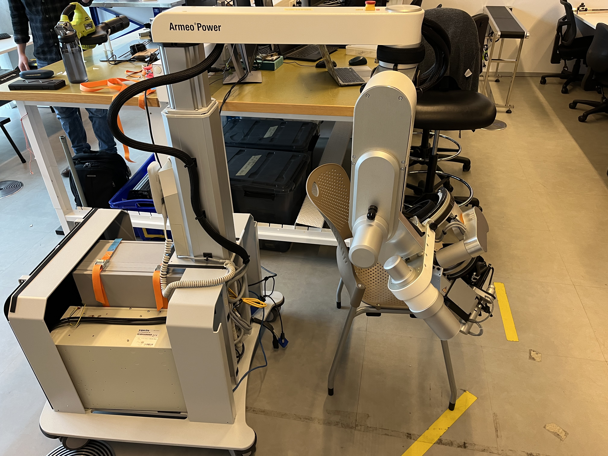
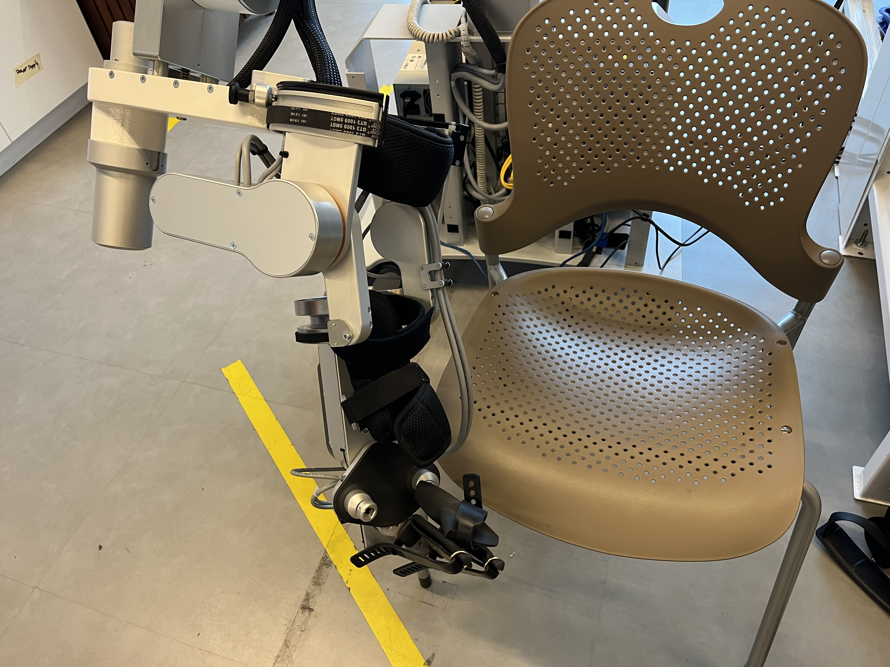
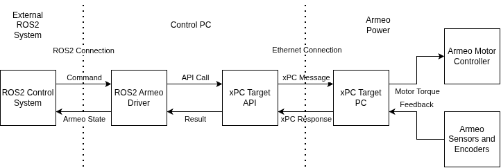
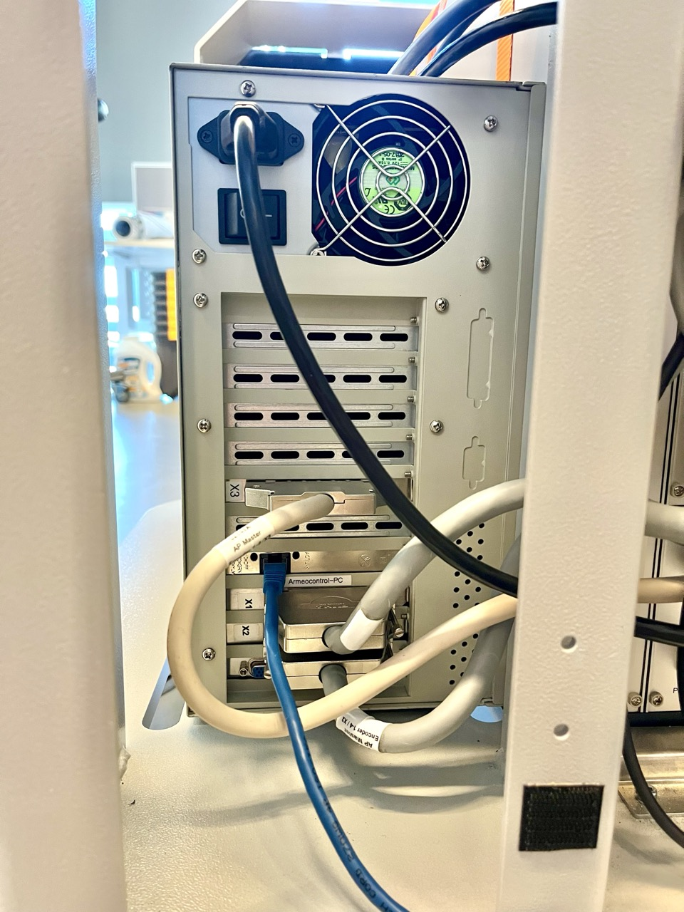

# Armeo Docs

This Repository is the documentation for a UTS Robotics Institute Project.

The Project's goal is to create a system to control the [Armeo Power Robotic Exoskeleton](https://www.hocoma.com/us/solutions/armeo-power/) through a native linux, ROS2 interface. 
This is to allow future research to be performed using the Armeo Power.

## What is the Armeo Power?

The Armeo Power is a 6 Degree of Freedom, upper limb robotic exokseleton made by Hocoma to perform therapy on patients with severe to moderate impairments. 
It comes with user control software that allows a degree of control, however this software does not allow full control of the Armeo Power exoskeleton that would be needed for more interesting research.

The Armeo Power is controlled via xPC Target, a system created by Mathworks as part of MATLAB to create and deploy real time models on a xPC Target PC. 
The control software communicates with the Armeo's Target PC through the xPC API.

Below you can see two images of the Armeo Power

*Side view of ArmeoPower exoskeleton, with base unit cover removed. (Image from [armeo_re](https://github.com/ashquarky/armeo-re))*

*Detail of the forearm part of the exoskeleton itself, joints 3 onwards. (Image from [armeo_re](https://github.com/ashquarky/armeo-re))*
## Setup

This project controls the Armeo directly by replacing the Armeo Control Software, communicating directly with the xPC Target PC over ethernet.

Typically to communicate with a xPC Target PC you would use either MATLAB directly, or the provided C library "xpcapi.dll". 
However MATLAB would not be compattible with ROS2 and the C library is only built for windows, therefore to achieve native linux compatibility [xpctarget_api_cpp](https://github.com/nathant127/xpctarget_api_cpp) was built as a replacement to the C library.
This was built by examining "xpcapi.dll" specifically the relationship between the API Calls, and the Network Packets that were sent as a result, and then designing a system that does the same.

This library was then used to create a native ROS2 driver for the Armeo.

Below is a diagram that shows each part of the system that allows the Armeo Power to be controlled.

*The Armeo Target PC, Note the ethernet cable that is used to communicate with the Target PC (Image from [armeo_xpc](https://github.com/ashquarky/armeo_xpc))*

## Documentation

| Document | Description |
|----------|-------------|
|[Armeo Power Info](/docs/armeo_power_info.md) | General information about the armeo power including dh parameters, joints, joint limits (Start here if new) |
|[xPC API Intro](/docs/xpc_api.md) | Introduction to how to use xpcapi to communicate with an xPC Target PC |
|[xPC Target Protocol](/docs/xpc_protocol.md) | Information about the xpcapi network protocol used to communicate with the xPC Target PC that controls the Armeo |
|[Armeo Control](/docs/armeo_control.md) | Information on how to control the Armeo Power using xPC API |
|[Armeo Signals](/data/armeo_signals.csv) | Full list of all signals in the Armeo Power Model |
|[Armeo Parameters](/data/armeo_parameters.csv) | Full list of all parameters in the Armeo Power Model |

## Avenues of Further Investigation

There are a number of areas that I have not had time to investigate, but could lead to improvements to how the Armeo is controlled and built

| Name | Description |
|------|-------------|
|Compile new Model | The .dlm that comes with the Armeo Power has a number of limitations that prevent us from ideal control, forcing us to use workarounds. If the .dlm could be loaded back into MATLAB and/or it could be modified, it could provide access to new, easier and more direct ways of controlling the Armeo, such as velocity control, end effector based control, reporting the end effector orientation and more |
| Other Operation Modes | Not all operation modes were explored, the explored operation modes can be seen in [Armeo Power Info](/docs/armeo_power_info.md), some seem interesting, such as the Haptic Planes mode and the User Trajectory mode |
| xPC API Extensions | Not all api functions were implemented as part of xpctarget_api_cpp, some, such as filesystem and scope functions were left unimplemented, and the error handling system was also left unimplemented in favor of c++ exceptions |

## Related Repositories

| Repository | Description |
|------------|-------------|
| [xpctarget_api_cpp](https://github.com/nathant127/xpctarget_api_cpp) | C++ library (derived from MathWorks' `xpcapi`) used by both the examples and the ROS driver to communicate with the ARMEO Power robot |
| [armeo_ros_driver](https://github.com/nathant127/armeo_ros_driver) | ROS 2 driver for the ARMEO Power robot |
| [armeo_msgs](https://github.com/nathant127/armeo_msgs) | A set of msgs for the armeo ros driver |
| [armeo_examples](https://github.com/nathant127/armeo_examples) | A simple set of examples for controlling the ARMEO Power robot |
| [armeo_re](https://github.com/ashquarky/armeo-re) | Repository that this project is based on, documentation, has more information about Armeo Power hardware |
| [armeo_xpc](https://github.com/ashquarky/armeo_xpc) | Repository that this project is based on, retrieves signals from the armeo power using ros2 on windows |

### Testing / Legacy

| Repository | Description |
|------------|-------------|
| [armeo_xpc_wine](https://github.com/nathant127/armeo_xpc_wine) | Old repository used for initial testing and development, running MathWorks' `xpcapi` library under Wine |
